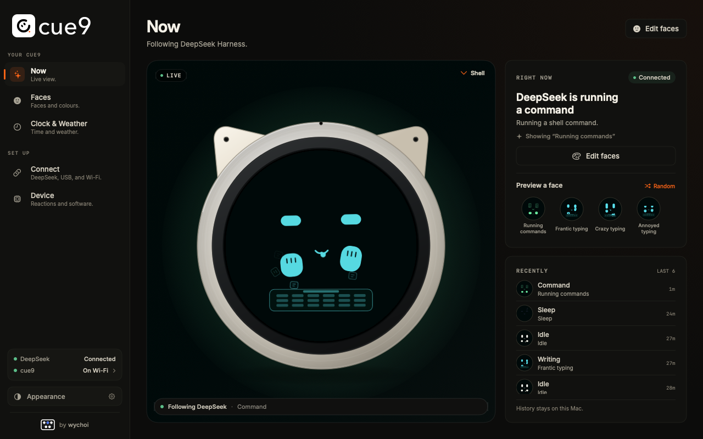

<picture>
  <source media="(prefers-color-scheme: dark)" srcset="brand/decided/final/cue9-lockup-white.svg">
  
</picture>

**A quiet control surface for a DSH-powered desk companion.** Currently supports the ESP32-S3 VoCat / EchoEar.

cue9 shows what DeepSeek Harness is doing on the companion’s round screen and lets you choose the face for each action. When the work goes quiet it keeps the time, and a swipe brings the weather.



*Companion view, following DSH.*


*Real device: working, sleep, approval, question, and done.*

## What it does

- **Mote** — the live face, the current cue, and a short local history. **Edit** maps actions to animations, sets expression and background colours, and tests a face on the mote.
- **Clock and weather** — the mote’s other two pages, fed by the Pi. Set the timezone, city, units, and clock format under **Device → Ambient**.
- **Device** — DSH plugin setup, the USB or Wi-Fi link, firmware flashing, and advanced settings.

## Run it

You need macOS 14 or newer, the Xcode command line tools, and DeepSeek Harness.

1. Install the DSH plugin. Download [dsh-cue9-mote](https://github.com/awychoi/dsh-cue9-mote), then in DSH open **Plugins → Add plugin** and choose the folder.
2. Build and open the app:

   ```bash
   ./app/Scripts/build-app.sh
   open app/build/cue9.app
   ```

3. cue9 finds DSH’s current local port automatically. If the plugin is not detected, open **Device**. If DSH runs elsewhere, set the address under **Advanced**.

Flashing firmware (needs `esptool`) and the wireless Pi link are optional; both live under **Device**.

The app stores the mapping, colours, and recent history in `~/.dsh/cue9/`. Delete `mapping.json`, the two colour files, and their `.backup.json` copies to reset the app to its defaults.

## Troubleshooting

- **Plugin not connected** — DSH may be closed, the plugin may not be installed, or the address may be wrong. The app cannot install the plugin for you.
- **USB found but the plugin is offline** — the app can see the mote and flash firmware, but the Mote page stays offline until the plugin connects.
- **No USB port listed** — check the cable, refresh the port menu, and make sure nothing else holds the port.
- **Build fails** — confirm macOS 14+, that `swift --version` works, and that the script runs from the repository root.

## Technical

How the app, plugin, Pi bridge, and firmware fit together: [ARCHITECTURE.md](ARCHITECTURE.md).

## License

GPL-3.0. See [LICENSE](LICENSE). Copyright © 2026 awychoi.

The bundled firmware is built with Espressif ESP-IDF and the Apache-2.0 ST77916 panel driver. See [THIRD_PARTY_NOTICES.md](THIRD_PARTY_NOTICES.md).

Inter is bundled under the SIL Open Font License; see [Inter-OFL.txt](app/Sources/Cue9App/Resources/Inter-OFL.txt).

---

Ideation and design by [wychoi](https://wychoi.com), created agentically.
