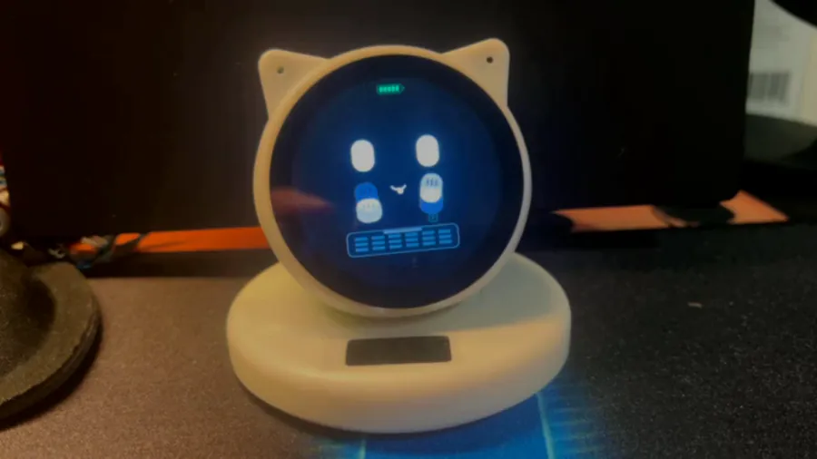

<picture>
  <source media="(prefers-color-scheme: dark)" srcset="brand/decided/final/cue9-lockup-white.svg">
  
</picture>
<p>

**A control surface for a DSH-powered desk companion.** Currently supports the ESP32-S3 VoCat / EchoEar.

cue9 shows what DeepSeek Harness is doing on the companion’s round screen. Approvals and questions can also go to your iPhone. A clock and weather app included.


*The Now page, following DeepSeek Harness.*



*Real device: working, sleep, approval, question, and done.*

## What it does

- **Now** — the live face, what DeepSeek is doing, and a short local history. Try a face without changing anything.
- **Faces** — choose which faces each moment can use, paint them, and show one on cue9.
- **Clock & Weather** — the companion’s two pages, previewed as they appear on the device. Set the city, timezone, units, and clock format.
- **Connect** — the DeepSeek add-on, the USB or Wi-Fi link, phone approvals, and keeping this Mac awake.
- **Device** — shake and stroke reactions, a software reinstall, and advanced settings.

## Run it

You need macOS 14 or newer, the Xcode command line tools, and DeepSeek Harness.

1. Install the DSH plugins. In DSH, open **Plugins → Add plugin**. For phone approvals, add this repo’s `phone/` folder first, so it loads before the mote plugin; then download [dsh-cue9-mote](https://github.com/awychoi/dsh-cue9-mote) and add it the same way.
2. Build and open the app:

   ```bash
   ./app/Scripts/build-app.sh
   open app/build/cue9.app
   ```

3. cue9 finds DSH’s current local port automatically. If the plugin is not detected, open **Connect**. If DSH runs elsewhere, set the address under **Device → Advanced**.
4. For phone approvals, install Tailscale on the Mac and iPhone, then open **Connect → Approvals on your phone → Set up phone** and follow the wizard.

Flashing the companion’s software (needs `esptool`) lives under **Device**; the wireless Pi link is under **Connect**.

Settings, recent history, and phone setup live in `~/.dsh/cue9/`. To reset the app, delete `mapping.json` and the colour files (and their `.backup.json` copies); remove phone setup from **Connect → Set up phone**.

## Troubleshooting

- **Plugin not connected** — DSH may be closed, the plugin may not be installed, or the address may be wrong. The app cannot install the plugin for you.
- **USB found but the plugin is offline** — the app can see cue9 and flash its software, but the Now page stays on the offline face until the add-on connects.
- **No USB port listed** — check the cable, refresh the port menu in **Device**, and make sure nothing else holds the port.
- **Phone can’t connect** — Tailscale must be running on the Mac and iPhone, on the same Tailscale network, or the home Wi-Fi fallback needs the DNS record shown in the app. Reopen **Connect → Set up phone**.
- **Clock or weather is wrong** — check the bridge is online, then open **Clock & Weather** to save the city and timezone again.
- **Build fails** — confirm macOS 14+, that `swift --version` works, and that the script runs from the repository root.

## Technical

How the app, plugins, Pi bridge, and firmware fit together: [ARCHITECTURE.md](ARCHITECTURE.md).

## License

GPL-3.0. See [LICENSE](LICENSE). Copyright © 2026 awychoi.

The bundled firmware is built with Espressif ESP-IDF and the Apache-2.0 ST77916 panel driver. See [THIRD_PARTY_NOTICES.md](THIRD_PARTY_NOTICES.md).

Inter is bundled under the SIL Open Font License; see [Inter-OFL.txt](app/Sources/Cue9App/Resources/Inter-OFL.txt).

---

Ideation and design by [wychoi](https://wychoi.com), created agentically with DeepSeek, Gemini and Claude.
